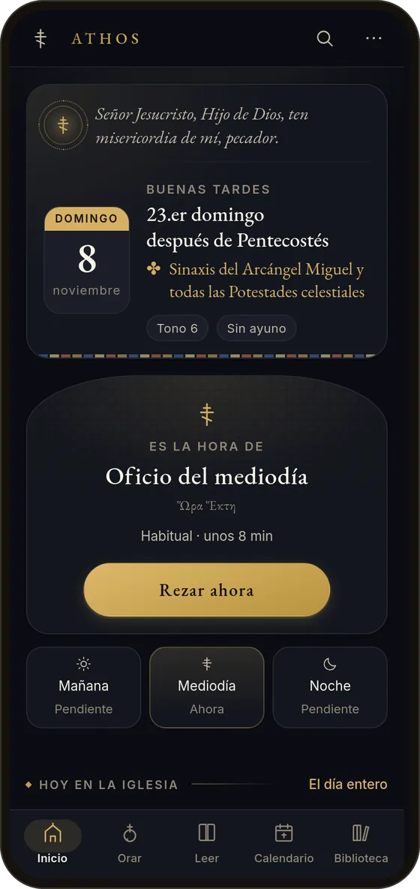
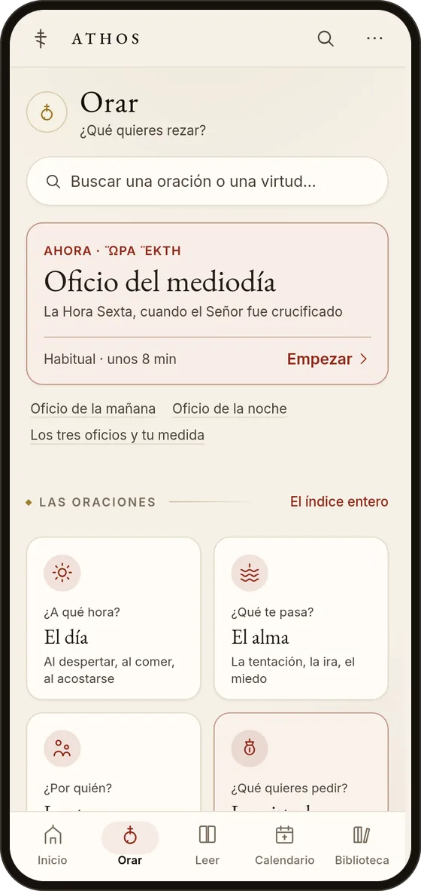
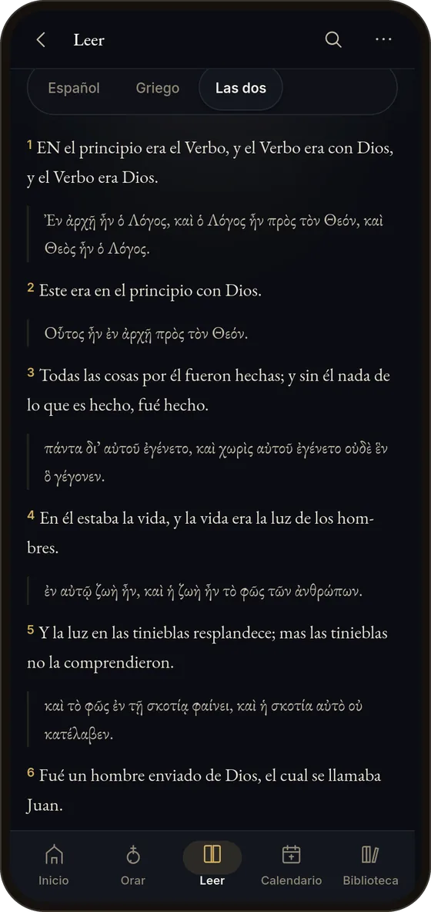
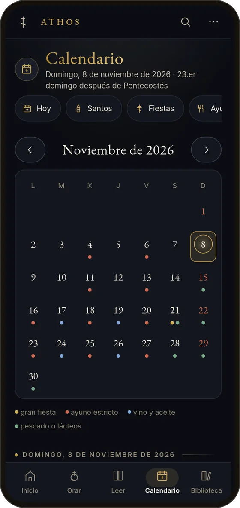
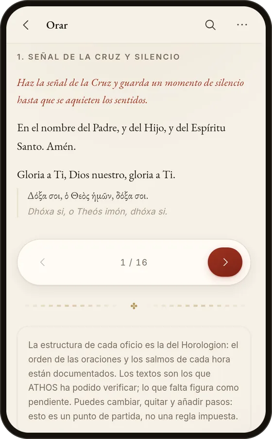
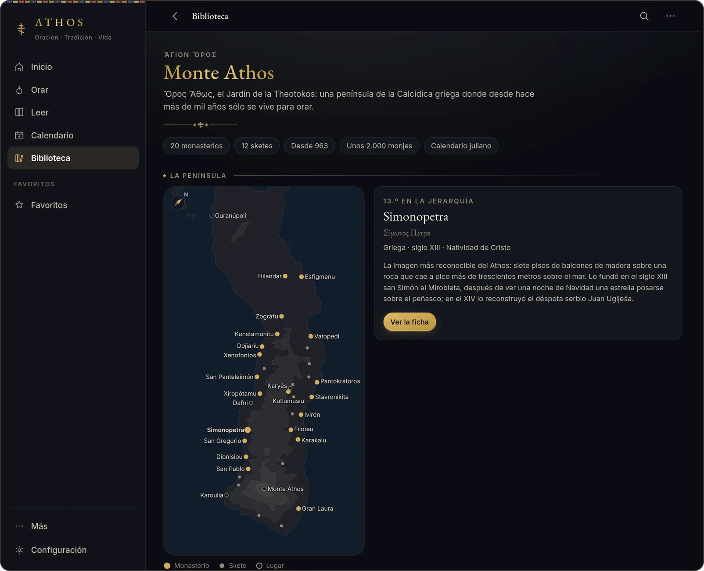
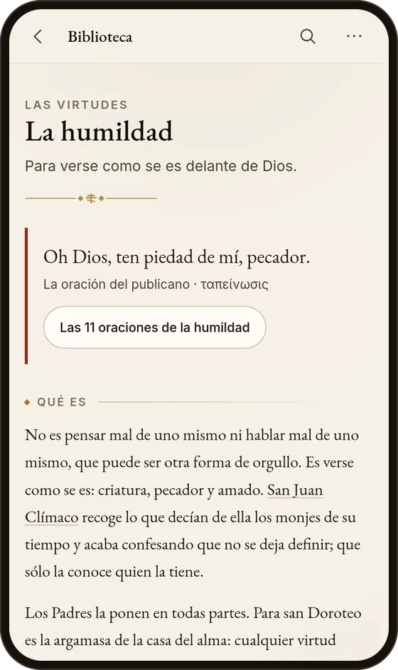

<p align="center">
  <a href="https://tomasito25.github.io/athos/">
    <picture>
      <source media="(prefers-color-scheme: light)" srcset="docs/readme/cabecera-pergamino.svg">
      
    </picture>
  </a>
</p>

<h3 align="center">Reza con la Iglesia cada día, estés donde estés.</h3>

<p align="center">
  El Horologion, la Biblia, el calendario litúrgico y una biblioteca ortodoxa<br>
  en una sola aplicación en español, que funciona sin conexión.
</p>

<p align="center">
  <a href="https://tomasito25.github.io/athos/"></a>
</p>

<p align="center">
  <b>Sin cuenta · Sin rastreo · Sin publicidad · Tus datos en tu dispositivo</b>
</p>

<p align="center">
  <a href="CHANGELOG.md"></a>
  <a href="https://github.com/Tomasito25/athos/actions/workflows/ci.yml"></a>
  <a href="LICENSE"></a>
  <a href="#instalarla"></a>
</p>

<p align="center">
  <a href="#orar">Orar</a> ·
  <a href="#leer">Leer</a> ·
  <a href="#calendario">Calendario</a> ·
  <a href="#monte-athos">Monte Athos</a> ·
  <a href="#biblioteca">Biblioteca</a> ·
  <a href="#instalarla">Instalarla</a> ·
  <a href="#contribuir">Contribuir</a>
</p>

<p align="center">
  
  
  
  
</p>

<table align="center">
  <tr>
    <td align="center"><b>+300</b><br><sub>oraciones</sub></td>
    <td align="center"><b>67</b><br><sub>momentos</sub></td>
    <td align="center"><b>23</b><br><sub>virtudes</sub></td>
  </tr>
  <tr>
    <td align="center"><b>3</b><br><sub>oficios al día</sub></td>
    <td align="center"><b>20</b><br><sub>monasterios del Athos</sub></td>
    <td align="center"><b>0</b><br><sub>cuentas, anuncios o rastreo</sub></td>
  </tr>
</table>

## Abres ATHOS y ya sabe qué día es

Qué semana es para la Iglesia, qué fiesta y qué santo se recuerdan, qué Evangelio
se lee, si se ayuna y en qué tono se canta. Y debajo, **el oficio que toca a esta
hora**, con un botón para empezar. En el calendario nuevo o en el juliano, el que
siga tu parroquia.

## Orar

 **¿Qué quieres rezar?** Es lo primero que pregunta, y la respuesta puede ser una
hora, un problema, una persona o una virtud.

- **Tres oficios al día** con la estructura del Horologion: mañana, Hora Sexta y
  Pequeñas Completas, con sus salmos y las fórmulas en griego. En tres medidas, y
  se pueden editar.
- **Oraciones por lo que hace falta, no por el título.** Más de trescientas, en
  sesenta y siete momentos y seis puertas: a qué hora, qué te pasa, por quién, qué
  quieres pedir, a quién rezas y con qué.
- **Oración de Jesús y komboskini**, con contador, temporizador e historial.
- **Nombres para la oración**: los vivos y los difuntos que encomiendas, rezados
  en su sitio en los oficios y en la panihida, con aviso el día de su santo.

<br clear="right">

## Leer

**La Escritura como la lee la Iglesia.**

- **La Biblia entera, con los libros de los Setenta.** La Reina-Valera de 1909 y,
  en los libros que ésta no trae (Tobías, Judit, Sabiduría, Eclesiástico, los
  Macabeos…), la Biblia libre para el mundo.
- **Al lado, si se quiere, el griego que lee la Iglesia**: los Setenta en la
  edición de Brenton y el Nuevo Testamento patriarcal de 1904, versículo a
  versículo.
- **Búsqueda sin conexión** y salto directo a una cita: se escribe «Juan 3, 16» y
  se abre el capítulo.
- **El Salterio** en la numeración de los Setenta, repartido en los veinte
  kathismata.
- **Las lecturas de cada día** del leccionario bizantino, recortadas al versículo
  exacto: no el capítulo entero, sino la perícopa que se lee.
- **Planes de lectura**: los Evangelios, el Nuevo Testamento, el Salterio o la
  Biblia entera, repartidos por días y con lo leído marcado.

## Calendario

**El año como lo cuenta la Iglesia.**

- **La Pascua ortodoxa, calculada de verdad**, con el tono del Octoecos, las
  fiestas y el ayuno de cada día. Cada semana lleva el nombre que le dan los
  calendarios ortodoxos: «22.º domingo después de Pentecostés», «3.ª semana de la
  Gran Cuaresma». Sin «tiempo ordinario», que es del rito latino.
- **Santoral completo**: no queda ningún día del año sin conmemoración, con la
  vida escrita de cada una.
- **Pascualia**: las Pascuas de los próximos años, con el comienzo del Triodio y
  de la Cuaresma, la Ascensión, Pentecostés y el ayuno de los Apóstoles en cada
  calendario.
- **Al calendario del teléfono**: las fiestas, los ayunos y los recordatorios de
  oración en un archivo `.ics`, que avisa aunque ATHOS esté cerrada.

## Monte Athos

**La Montaña, sobre un mapa de verdad.** La costa y el relieve de la península,
trazados del modelo de elevación de la NASA, y en él los veinte monasterios, los
doce sketes, Karyés, Dafni y la cumbre, cada uno en sus coordenadas.

<p align="center">
  
</p>

De cada monasterio, lo que es hoy, quién vivió en él, qué custodia, sus sketes y
su fiesta, con el día civil en que cae, porque la Montaña sigue el calendario
juliano. El año entero de sus fiestas y las de sus iconos, y trece artículos: el
gobierno, Karyés, el ávaton, los sketes, el canto y cómo se llega.

## Biblioteca

 **Los libros de la Iglesia, y lo que hace falta para leerlos.**

- **Las virtudes, una por una.** Veintitrés fichas: qué es cada una, lo que se le
  opone, cómo se empieza, qué dicen la Escritura y los Padres, en qué santos se ve
  y con qué oraciones se pide.
- **Catecismo** de 108 preguntas, filtrable según se llegue de fuera, se sea
  catecúmeno o se lleven años dentro. Dice también lo que la Iglesia no ha definido.
- **Padres de la Iglesia**, de san Ignacio de Antioquía a san Sofronio de Essex:
  qué enseñó cada uno y por dónde empezar a leerlo.
- **Historia de la Iglesia** de Pentecostés a hoy, con la ficha de cada Concilio y
  los conflictos abiertos contados como conflictos.
- **Monasterios del mundo ortodoxo**: diecinueve casas, del Sinaí a las Solovkí,
  en su mapa.

<br clear="right">

<details>
<summary><b>Y además…</b></summary>

- **Las Iglesias ortodoxas hoy**: una ficha por Iglesia con quién la preside y
  cuándo se comprobó, su sede, su calendario, sus lenguas y sus diócesis en España
  y América Latina; y las disputas abiertas, contadas como disputas.
- **Mapas sobre la costa de verdad**: Tierra Santa con los lugares del Evangelio
  enlazados a sus pasajes, los cuatro viajes de san Pablo, las siete Iglesias del
  Apocalipsis y las sedes de la Iglesia época por época.
- **El templo, parte por parte**, un glosario de los términos que se usan y cursos
  de estudio para quien empieza.
- **Los nombres se pinchan.** Un santo, un Padre, una obra suya o un monasterio
  nombrados en cualquier texto llevan a su ficha. En el texto litúrgico, nunca: una
  oración se muestra tal como es.
- **El versículo y el apotegma del día** en Inicio y, si se quiere, como avisos
  aparte.
- **Compartir y leer en voz alta** un versículo, una oración o la vida de un santo,
  con la voz del propio dispositivo; y la pantalla encendida mientras se reza un
  oficio.
- **Dos temas que salen de los libros de la Iglesia**: el pergamino, en tinta y
  cinabrio como un libro litúrgico impreso, y la vigilia, en azul de noche y oro de
  lámpara. Con ornamentos bizantinos dibujados con trazo, que se pueden apagar.

</details>

<p align="center"></p>

## Instalarla

Abre **[tomasito25.github.io/athos](https://tomasito25.github.io/athos/)** y
añádela a tu dispositivo. No pasa por ninguna tienda: es la misma web, guardada en
tu teléfono.

| | |
| --- | --- |
| **Android** (Chrome, Brave) | Menú **⋮** → *Instalar aplicación* |
| **iPhone y iPad** (Safari) | **Compartir** → *Añadir a pantalla de inicio* |
| **Ordenador** (Chrome, Edge, Brave) | El icono de instalar en la barra de direcciones |

Después se abre en su propia ventana, arranca al instante y **funciona entera sin
conexión**: la Biblia, el Salterio, el calendario y las oraciones quedan en el
dispositivo. **No envía nada tuyo a ningún servidor**: sólo pide a GitHub, donde
está publicada, los textos la primera vez que se abren y, cada hora mientras está
abierta, si hay versión nueva. Lo detalla la
[política de privacidad](https://tomasito25.github.io/athos/privacidad.html).

Lo tuyo —reglas, favoritos, avance— vive sólo en ese dispositivo y en ese
navegador. **Haz una copia de vez en cuando** (Configuración → Datos): Safari
puede borrar los datos de una web que no se abre en semanas, y la copia es lo único
que los recupera.

## La regla de la casa

> **Aquí no se inventa un texto litúrgico.**
>
> Cuando una oración, un himno o una traducción no está disponible con licencia
> comprobada, se conserva su ficha completa y el cuerpo se marca como *pendiente
> de incorporar*. Antes que un texto aproximado, una ficha honesta.

Cada texto lleva su procedencia —autor, traductor, fuente, tradición, idioma,
licencia y derechos— y se puede consultar entera en **Configuración → Fuentes**. Lo
que ATHOS traduce o redacta por su cuenta se identifica como tal en su ficha: nunca
se hace pasar por la edición de un libro litúrgico.

Lo mismo con lo que la aplicación hace: si algo no funciona —las notificaciones sin
servidor, la sincronización que aún no existe— la interfaz lo dice en vez de
simularlo.

## Contribuir

ATHOS es software libre y agradece la ayuda. Hay cuatro maneras de darla, de más
útil a menos:

1. **Textos litúrgicos en español con licencia comprobada.** Es lo que más falta.
   Cualquier ficha marcada como *pendiente de incorporar* en **Configuración →
   Fuentes** es una contribución esperando a alguien.
2. **Correcciones al calendario y al ayuno.** Si una fecha, un tono o un grado de
   ayuno no cuadra con tu jurisdicción, díselo, con la fuente que lo respalde. Las
   diferencias entre tradiciones son reales y ATHOS quiere reflejarlas, no
   aplanarlas.
3. **Revisión de los textos.** Un sacerdote, un teólogo o alguien que conozca los
   libros litúrgicos en español puede decir si una oración coincide con un libro
   publicado o si una traducción está bien hecha. Hay textos tradicionales sin
   verificar y traducciones propias: [docs/PROCEDENCIA.md](docs/PROCEDENCIA.md) lista
   uno por uno lo que hay que comprobar.
4. **Código.** Errores, accesibilidad, rendimiento. El criterio principal es que
   nada se dé por bueno sin una prueba que lo respalde.

Toda aportación de contenido trae su procedencia completa y dice con claridad si es
un texto tradicional, una traducción con licencia o algo redactado para ATHOS. Lo
tercero se acepta; lo tercero disfrazado de lo primero, no. Si un texto se incorporó
por error y tienes derechos sobre él, escríbelo en una incidencia: **se retira
primero y se discute después**.

ATHOS está sólo en español, interfaz y contenido: no hay mecanismo de traducción, y
traducir la interfaz sin traducir las oraciones serviría de poco.

<details>
<summary><b>Ponerla en marcha para programar</b></summary>

```bash
git clone https://github.com/Tomasito25/athos.git
cd athos && ./run.sh
```

Sólo hace falta **python3** para usarla; Node únicamente para compilar, y `run.sh`
lo encuentra solo si está en `~/.local/node`. Antes de proponer un cambio:

```bash
npm run check
```

Eso pasa el lint, los tipos, las pruebas y la compilación: lo mismo que comprueba
GitHub en cada empujón. Son más de mil pruebas automáticas: entre otras cosas, abren
de verdad cada cita bíblica de las oraciones.

</details>

Lo largo está en **[CONTRIBUTING.md](CONTRIBUTING.md)**: qué licencias se aceptan,
cómo se distingue una rúbrica de una oración, y qué hacer con el calendario
litúrgico, que es la parte más delicada del proyecto.

**[Informar de un error](https://github.com/Tomasito25/athos/issues/new)** ·
**[Ver los abiertos](https://github.com/Tomasito25/athos/issues)** ·
**[Privacidad](https://tomasito25.github.io/athos/privacidad.html)**

## Licencias

Código bajo [AGPL-3.0-or-later](LICENSE). El contenido religioso conserva cada uno
su propia licencia, declarada en su ficha y visible en la aplicación; ver
[NOTICE.md](NOTICE.md). Los cuatro textos bíblicos son de dominio público: Reina-Valera
1909, Biblia libre para el mundo, los Setenta de Brenton (1851) y el Nuevo Testamento
patriarcal de 1904. EB Garamond e Inter, SIL Open Font License 1.1. **La licencia del
código no cubre el contenido religioso de terceros.**

Las imágenes de esta página son capturas de la propia aplicación y una cabecera
dibujada con los datos de su mapa, del relieve SRTM y las coordenadas de Wikidata;
las líneas del mar son adorno.

<p align="center"></p>

<p align="center"><i>Señor Jesucristo, Hijo de Dios, ten misericordia de mí, pecador.</i></p>
